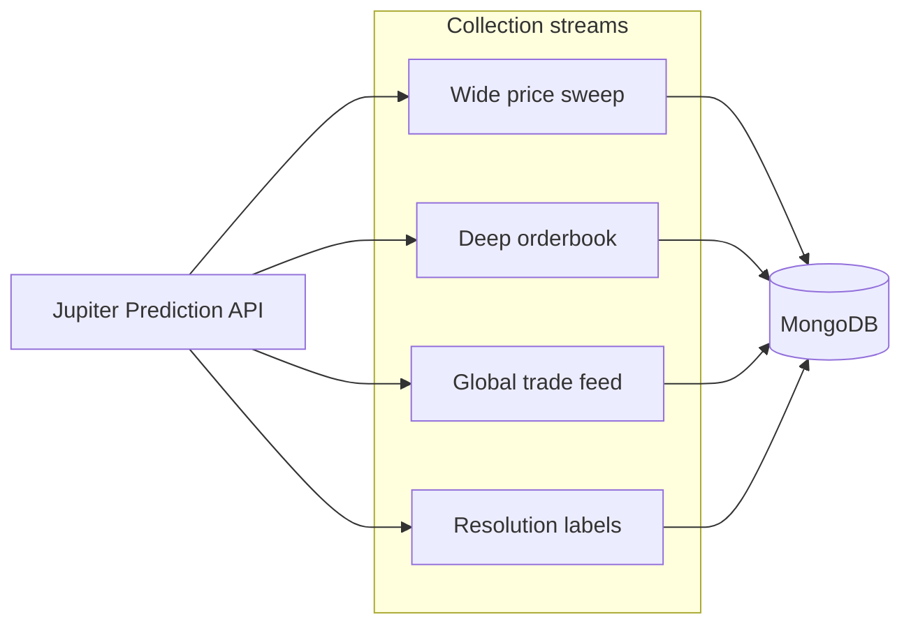
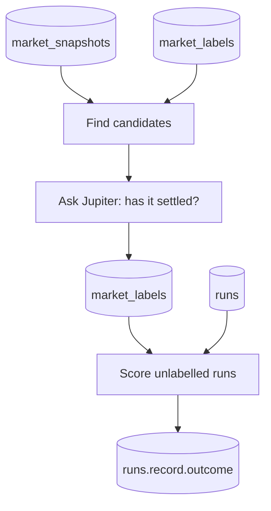
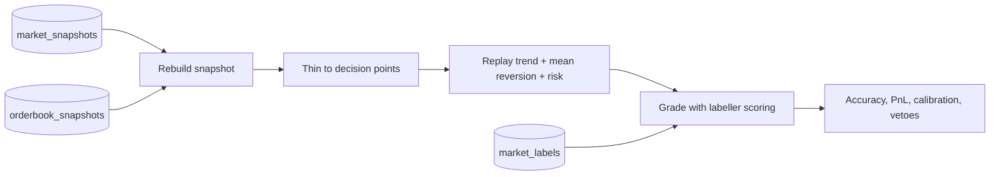
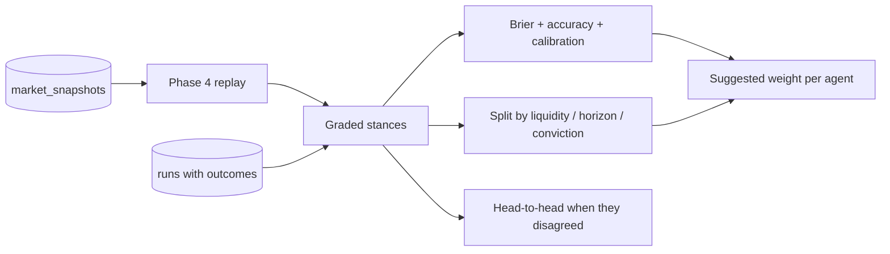

# Research dataset

How to gather a time-series research dataset from the Jupiter Prediction API —
including prices, order books, and trades — and how often to refresh it so the
data stays useful.

This is a **design document**, not a feature that exists in the app yet. It
answers the question in `docs/tasks/11.md` and is grounded in:

- the live Jupiter Prediction API (OpenAPI + docs)
- the existing PMTrader client in `api/src/jupiter/`
- the intent recorded in the Obsidian vault notes under
  *Prediction Market Trader / ChatGPT Q&A*

The goal is **not** to train a neural network. It is to build what quantitative
trading firms call a **research dataset**: a growing archive of how markets
behaved, so the swarm can later measure which of its own specialists deserve
trust under which conditions. That feedback loop is the missing piece described
in `docs/Analysis.md`.

**Status:** Phases 0–5 are done. Phase 0 normalised snapshot units; Phase 1 is the
adaptive collector (`COLLECTOR_ENABLED=true`, schedule in
`api/src/collector/collector-schedule.json`); Phase 2 is the Feature Builder
(`api/src/features/`) plus the Angular `/data` dashboards; Phase 3 is the outcome
labeller (`api/src/labeller/`, `LABELLER_ENABLED=true`); Phase 4 is the offline
backtest (`api/src/backtest/`, `/data/backtest` in the UI); Phase 5 is agent
fitness (`api/src/fitness/`, `/data/fitness` in the UI).

---

## The constraint that shapes everything

The Jupiter Prediction API has **no historical endpoint**.

There are no candles, no price history, and no "give me this market's last
N hours" call. The trade feed (`GET /trades`) accepts **no query parameters at
all** — no market filter, no time range, no pagination. It is a rolling window
of recent fills across every market. Confirmed against the live OpenAPI:

```yaml
paths:
  /trades:
    get:
      tags: [Trades]
      responses:
        '200': { description: Recent order_filled events }
```

So the dataset can only ever be as good as your polling. Anything you miss
between two polls is permanently lost. That makes **cadence a correctness
question**, not a tuning knob.

---

## Snapshot normalisation (Phase 0 — done)

Every collected row must use the same units and orderbook rules as the swarm.
That conversion already lives in
[`api/src/agents/market-analyst/logic.ts`](../api/src/agents/market-analyst/logic.ts)
via `buildMarketSnapshot` / `summariseDepth`. The collector should reuse those
helpers (or the same conventions) so research data and live runs stay
comparable.

### Prices are native micro-USD until converted

Jupiter often returns market prices in **native token units** where
`1,000,000 = $1.00`. A price of `$0.65` arrives as `650000`.

`toUsdPrice` now:

- divides values **above 1** by `1_000_000`
- leaves values already in **0..1** alone
- falls back to **0.5** when a quote is missing

The Angular UI already did this for display (`formatMicroUsd`). The swarm path
matches that behaviour, so agents see real probabilities instead of everything
clamped to `1.0`.

Older saved runs (and sample exports such as `run.json`) may still show all
prices as `1` and `impliedYesProbability` as `0.5`. Treat those as **pre-fix
artefacts**, not as a model of current behaviour. Re-run a market after the
fix if you need a clean baseline.

### Best bid is the highest price on each side

Jupiter sorts bid levels **ascending** (cheap → expensive). `summariseDepth`
takes the **maximum** price on each side as `bestPriceUsd`, not `levels[0]`
(which is the cheapest bid).

### Bids on both sides (modelling, not a bug)

`yes` and `no` are **both bid arrays**. There is no ask side in the response,
because in a binary market buying NO at price `p` is economically the same as
selling YES at `1 − p`.

Derived microstructure the feature builder should compute **on read**:

| Concept | Formula |
|---------|---------|
| Best YES bid | highest price in `yes_dollars` |
| Best NO bid | highest price in `no_dollars` |
| Implied YES ask | `1 − best_no_bid` |
| Mid | `(best_yes_bid + implied_yes_ask) / 2` |
| Spread | `1 − best_no_bid − best_yes_bid` |
| Depth imbalance | `(yesQty − noQty) / (yesQty + noQty)` |

Today `deriveFeatures` still uses `|buyYes − sellYes|` for `spreadUsd`. That is
fine for live swarm maths; the binary mid/spread above is the richer definition
to add when building research features from stored books. Store the raw levels;
recompute either definition later without re-collecting.

---

## What we can and cannot get from Jupiter

| Endpoint | What it gives | Useful for dataset? |
|----------|---------------|---------------------|
| `GET /events?includeMarkets=true` | Many events with nested markets, each carrying current pricing and volume | **Yes** — cheapest way to snapshot prices across many markets in one request |
| `GET /markets/{marketId}` | Full detail for one market (title, rules, status, result, pricing, close time) | **Yes** — for deep capture and resolution labelling |
| `GET /orderbook/{marketId}` | Current bid depth on YES and NO (`yes`/`no` cents, `yes_dollars`/`no_dollars` strings) | **Yes** — the highest-value microstructure signal |
| `GET /trades` | Recent fills across **all** markets (no filters) | **Yes** — but only if polled often enough not to miss fills |
| `GET /events/scores` | Live sports scores | Optional — useful for sports markets only |
| `GET /trading-status` | Whether the exchange is accepting trades | Operational health, not research data |
| Historical candles / price history | — | **Does not exist** |
| Filtered / paginated trade history by market | — | **Does not exist** on `/trades` |

Wallet-specific history (`GET /history?ownerPubkey=…`) is useful for
**PMTrader's own trades**, not for a general market research dataset. Keep that
path separate (Layer 3 below).

---

## The four collection streams

Think of the collector as four independent streams that share one rate-limit
budget.



### 1. Wide price sweep

Call `GET /events?includeMarkets=true` (paginated) a few times per minute.
One response carries pricing and cumulative volume for many markets at once.

When `wideSweep.options.categories` is set (e.g. `["crypto"]`), the collector
calls `/events?category=crypto` instead of pulling every market on the venue.
That keeps MongoDB focused on short-horizon price markets — *"Will Bitcoin be up
in the next hour?"*, *"Will Solana reach $100 by …?"* — rather than politics
and sports you are not training on yet. With `autoWatchlistSize`, the top open
markets by volume are written back to `marketIds` so orderbook depth follows the
liveliest crypto markets automatically.

Store, per market per sweep:

- timestamp
- marketId, eventId, title, status, category
- buy/sell yes/no prices (**already converted to 0..1 USD**, same as `toUsdPrice`)
- volumeUsd
- closeTime / hoursToClose

**Bonus:** the difference in `volumeUsd` between two sweeps recovers
per-interval volume even when individual trades were missed on the trade feed.

### 2. Deep orderbook

Call `GET /orderbook/{marketId}` only for a prioritised subset (see cadence
below). Store:

- timestamp, marketId
- full `yes_dollars` / `no_dollars` levels (compact)
- a content hash so unchanged books are not rewritten

Optionally cache derived best bid / implied ask / mid / spread for convenience,
but prefer recomputing those on read so definitions can evolve.

### 3. Global trade feed

Call `GET /trades` often. Upsert by trade `id` so duplicates are harmless.
Store:

- id, timestamp, marketId, ownerPubkey
- action (buy/sell), side (yes/no)
- amountUsd, priceUsd
- eventTitle / marketTitle (denormalised for convenience)

### 4. Resolution / outcome labels

When a market's `status` leaves `open`, or `result` becomes `yes`/`no`, write a
label row (or patch the market's metadata document). Every earlier snapshot for
that market then inherits a supervised label without rewriting history.

This is the same idea as the swarm's existing `PATCH …/outcome` path, but for
**markets**, not just PMTrader's own analysis runs.

The collector's `labels` stream covers only the handful of ids in
`collector-schedule.json`. Everything else the wide sweep collected is handled by
the Phase 3 labeller below.

---

## Storage design

Keep the existing `runs` collection for swarm analyses. Add three new
collections beside it. Prefer MongoDB **time-series collections** where the
driver supports them (`timeField` + `metaField`), because the access pattern is
"give me everything for market X between t0 and t1".

| Collection | Time field | Meta | Purpose |
|------------|------------|------|---------|
| `market_snapshots` | `capturedAt` | `marketId` | Wide-sweep price rows |
| `orderbook_snapshots` | `capturedAt` | `marketId` | Deep book captures |
| `trades` | `timestamp` | `marketId` | Fills from `/trades` (unique on trade `id`) |

### Store raw; compute features on read

Do **not** bake momentum, imbalance, or volatility into the write path.

| At write time | At read / feature-build time |
|---------------|------------------------------|
| Prices in correct 0..1 USD units | Momentum over 1m / 5m / 10m |
| Raw orderbook levels + hash | Binary mid/spread, imbalance, depth slope, VWAP |
| Individual fills | Trade rate, buy/sell imbalance |
| Market status / result | Outcome labels on every prior snapshot |

A better feature definition later must never force a re-collect. That is the
whole point of a research dataset.

### Suggested document shapes (illustrative)

```typescript
// market_snapshots
{
  capturedAt: Date,
  marketId: string,
  eventId?: string,
  title: string,
  status: string,
  result: 'yes' | 'no' | null,
  buyYesPriceUsd: number,   // 0..1 after toUsdPrice
  buyNoPriceUsd: number,
  sellYesPriceUsd: number,
  sellNoPriceUsd: number,
  volumeUsd: number,
  closeTime: number | null,
}

// orderbook_snapshots
{
  capturedAt: Date,
  marketId: string,
  yesDollars: Array<[string, number]>,
  noDollars: Array<[string, number]>,
  contentHash: string, // skip write when unchanged
}

// trades
{
  id: string,          // Jupiter trade id — unique index
  timestamp: Date,
  marketId: string,
  ownerPubkey: string,
  action: 'buy' | 'sell',
  side: 'yes' | 'no',
  amountUsd: string,
  priceUsd: string,
  eventTitle?: string,
  marketTitle?: string,
}
```

---

## Outcome labeller (Phase 3 — done)

Lives in [`api/src/labeller/`](../api/src/labeller/). Enabled with
`LABELLER_ENABLED=true`.

Collecting price history is only half the job. Until you know **how each market
actually ended**, none of that history can tell you whether a strategy was any
good. The labeller supplies the missing answer key.

### What it does, twice per pass



**Step 1 — label markets.** Fold `market_snapshots` down to the latest state per
market, drop anything already labelled decisively, and keep what looks settled.
Each survivor costs one `GET /markets/{id}`, so only a small batch is checked per
pass.

**Step 2 — score runs.** Load stored swarm runs that still have `outcome: null`,
look up their market's label, and write the outcome. This is what turns Layer 2
(what the market did) into Layer 3 (whether *we* were right).

### Picking candidates

A market is worth a Jupiter call when one of these holds:

| Reason | Meaning |
|--------|---------|
| `past-close` | The collected `closeTime` has passed |
| `status-changed` | The latest snapshot showed a status other than `open` |
| `awaiting-result` | Already labelled as closed, but Jupiter has not published a winner |

Candidates are ordered by close time, oldest first, so the markets most likely to
have resolved are checked before newer ones when the batch size bites.

`awaiting-result` matters more than it looks: Jupiter routinely stops trading
before it publishes the winning side, so a market must be re-checked rather than
labelled once and forgotten.

### Settled is not the same as decisive

Two separate ideas, deliberately kept apart:

- **Settled** — trading has stopped (`status` left `open`, or a result exists).
- **Decisive** — there is a winning side (`result` is `yes` or `no`).

A market can be settled without being decisive: void, cancelled, or simply not
yet adjudicated. Only decisive markets can score a past recommendation, so only
they count toward `resolvedMarkets`.

### Scoring a recommendation

Pure functions in [`api/src/labeller/scoring.ts`](../api/src/labeller/scoring.ts),
shared with the manual `PATCH /api/swarm/analyses/:id/outcome` route so both paths
score identically.

| Field | Rule |
|-------|------|
| `wasCorrect` | `buy_yes` matched `yes`, or `buy_no` matched `no`. **Null** for `hold` — refusing to bet says nothing about skill |
| `realizedPnlUsd` | Hypothetical: what the stake would have returned. **Null** when the entry price is unusable |
| `resolved` / `resolvedTo` | Straight from the market label |

The PnL maths follows from how binary markets pay out. A contract settles at
exactly $1 if it resolves your way and $0 otherwise, so buying at price `p` costs
`p` per contract and a stake of `S` buys `S / p` of them:

| Case | Profit |
|------|--------|
| Correct | `S × (1 − p) / p` — $50 at $0.20 returns **+$200** |
| Wrong | `−S` — the contracts expire worthless |
| `hold` | `0` — no position was taken |

Pre-Phase-0 runs stored every price as `0` or `1`. Those produce `null` rather
than a fabricated number, because a wrong PnL would quietly poison the Phase 5
fitness statistics.

### Cadence and cost

| Setting | Default | Why |
|---------|---------|-----|
| `LABELLER_INTERVAL_MS` | 600000 (10 min) | Resolution is not urgent; a settled market stays settled |
| `LABELLER_MARKET_BATCH_SIZE` | 5 | 5 requests per 10 minutes ≈ 0.5/min from the shared 60/min budget |
| `LABELLER_RUN_BATCH_SIZE` | 100 | MongoDB only — no Jupiter cost |

The loop uses a self-rescheduling `setTimeout` rather than `setInterval`, so the
next delay only begins once the current pass has finished. Overlapping passes are
structurally impossible — the bug `setInterval` leaves open in the older swarm
scheduler (see [`docs/schedule.md`](./schedule.md)).

At the default batch size a backlog of ~860 unlabelled markets takes roughly a day
to work through. Raise `LABELLER_MARKET_BATCH_SIZE` to clear it faster, at the
cost of interactive headroom.

### Endpoints

| Method | Path | Purpose |
|--------|------|---------|
| `GET` | `/api/labeller/status` | Config, last pass, outstanding candidates and runs, preview of what is next |
| `POST` | `/api/labeller/run` | Run one pass now (409 if one is already running) |
| `GET` | `/api/data/labelled` | Markets with a decisive result, plus how much history backs each |

`GET /api/data/overview` also reports `labelledMarkets` (any label) alongside
`resolvedMarkets` (decisive only). The gap between those two numbers is the count
of markets that stopped trading but have not been adjudicated.

---

## Offline evaluation (Phase 4 — done)

Lives in [`api/src/backtest/`](../api/src/backtest/). There is **no enable flag**,
because unlike the collector and the labeller it never runs on a timer: it makes
no Jupiter calls, reads MongoDB only, and answers a question you ask deliberately.

Phases 1–3 built an archive of what markets did and how they ended. Phase 4 is
the first phase that asks a question of it: **would our own decision rules have
made money on markets we now know the answer to?**



### The rule that makes a backtest worth trusting

**Look-ahead bias** means letting a past decision see information that did not
exist yet. It is the easiest way to build a backtest that looks brilliant and
loses money live, so the rule here is absolute: a decision made at time T may use
only rows captured at or before T. Three places enforce it:

| Where | How |
|-------|-----|
| Orderbook join | Reuses `asOfOrderbook` from the Feature Builder — nearest book **at or before** the snapshot, never after |
| Time to close | Every agent is called with `now` = `snapshot.capturedAt`, not the wall clock |
| Outcome | The label is only consulted after the decision has been produced |

The second one is subtler than it looks. `deriveFeatures` defaults `now` to
`new Date()`. Leave that default in place and every replayed market looks long
expired, the Risk Manager vetoes on "past close time", and the backtest silently
reports nothing.

### One decision per interval, not one per snapshot

The collector may write a snapshot every thirty seconds. Grading all of them
would turn a single opinion held for a day into ~2,880 "independent" tests and
make a fragile result look statistically solid.

Decisions are therefore thinned to one per `decisionIntervalMinutes` (default 15).
That number is a genuine research choice, not a performance tweak: shorten it and
you measure the same view repeatedly; lengthen it and you may miss the window
where an edge existed.

### The semantic agent sits this one out

Only the **quantitative core** is replayed — Trend, Mean Reversion, and the Risk
Manager. That is a limitation to keep in mind when reading any result, and there
are three separate reasons for it:

1. It calls a language model, so tens of thousands of decision points would take
   hours and cost money.
2. It is not deterministic, so the same history would score differently each run
   and nothing could be attributed to a code change.
3. It reads the market's resolution rules, and the collector never stored them.
   Feeding it *today's* rules for a settled market would hand it a hint the live
   agent never had — look-ahead bias by another route.

### A number is meaningless without a baseline

Every decision is scored twice: once for the swarm's logic, and once for
**buying whichever side the market already favours**. Prediction-market
favourites usually win, so "70% correct" can easily be worse than doing no
analysis at all. The baseline is what tells the two apart.

Because the baseline always stakes the maximum while the Risk Manager sizes down,
raw profit is not comparable. **Return on stake** — profit per dollar risked — is,
and that is the row to read.

### Accuracy and calibration are different questions

| Measure | Question | Why it matters |
|---------|----------|----------------|
| Accuracy | Of the bets we placed, how many picked the winning side? | Whether the strategy is directionally right |
| Calibration | When we said "70% likely YES", did ~70% resolve YES? | Whether the *confidence* can be trusted |

Phase 6 cannot weight a specialist whose confidence is meaningless, so the
calibration table is the part of this report Phase 5 actually consumes. It is
built over every decision including holds — declining to bet does not stop the
swarm having had an opinion about the probability.

### Why nothing was graded (the honest first result)

Run the backtest against the current dataset and every decision comes back
`hold`. That is not a bug, and the veto tally in the report says exactly why. Two
causes, one about the data and one about the strategy:

**The data.** The only markets the labeller has resolved so far were first seen
*after* they stopped trading. Their snapshots carry `status: "closed"`, no live
quote (so the implied probability falls back to 0.5), and zero hours to close.
The Risk Manager correctly refuses to trade all of them. This fixes itself as the
collector keeps running: markets it watches while open will settle in time.

**The strategy.** This one does not fix itself, and it is the real finding.
Trend and Mean Reversion are designed as opposites, and
[`aggregate.ts`](../api/src/agents/risk-manager/aggregate.ts) prices their
disagreement in directly as `confidence = meanConfidence × agreement`. Replaying
a synthetic market priced at 78% YES with healthy depth shows what that costs:

| Signal | Stance | Confidence |
|--------|--------|-----------|
| Trend | yes | 0.639 |
| Mean Reversion | no | 0.627 |
| **Blended** | — | **0.006** |

Two confident specialists annihilate each other. Push the price the other way to
a mild 62% and Mean Reversion goes neutral instead — but `meanConfidence` divides
by the number of signals *including* the neutral one, halving the survivor to
0.24. Either way the blend lands far below the 0.55 approval bar.

So the quantitative core, on its own, almost never trades. The swarm's
directional opinions come largely from the Semantic Agent — the one component
this backtest cannot replay. That is worth knowing before tuning anything else,
and it is precisely the kind of structural fact a backtest exists to surface.

`minConfidence` is overridable per run so the threshold can be swept without
editing `.env` and restarting. Every other risk limit stays at its production
value, so the result still describes the system that is actually deployed.

### Endpoints

| Method | Path | Purpose |
|--------|------|---------|
| `GET` | `/api/backtest/status` | Defaults, whether a run is in flight, how many resolved markets exist, last result |
| `POST` | `/api/backtest/run` | Replay every resolved market now (409 if one is already running) |
| `GET` | `/api/backtest/markets/:marketId` | Every graded decision for one market |

Query overrides on `run` and the market route: `markets`, `intervalMinutes`,
`minSnapshots`, `minConfidence`, `requireOrderbook`.

`requireOrderbook=true` narrows the sample to decisions that had real depth
behind them. The wide sweep covers hundreds of markets but the orderbook stream
only covers the watchlist, so by default most decisions are made blind to depth —
the report says how many, and that number is worth checking before believing any
imbalance-driven result.

The Angular UI exposes all of this at **`/data/backtest`**.

### Nothing is persisted

A backtest result is a *derived* view, exactly like the Phase 2 features. If the
maths improves, re-run it; there are no stale rows to migrate. The only thing
kept is the last summary, held in memory so the dashboard has something to show
on load.

---

## Agent fitness (Phase 5 — done)

Lives in [`api/src/fitness/`](../api/src/fitness/), dashboard at `/data/fitness`.
Like the backtest there is **no enable flag**: it makes no Jupiter calls, reads
MongoDB only, and answers a question you ask deliberately.

Phase 4 graded the swarm's *blended* recommendation and found the blend almost
always holds — which makes it a poor thing to measure. But each specialist still
took a side at every decision point, and those stances can be graded whether or
not the Risk Manager acted on them. That is what Phase 5 measures: not "did we
trade well?" but **"which specialist deserves trust, and under what
conditions?"**.



### Two sources of evidence, never silently merged

| Source | What it covers | Why it is not enough alone |
|--------|----------------|----------------------------|
| `backtest` | Stances replayed from collected history | Deterministic and plentiful, but the semantic agent cannot be replayed, so it never appears |
| `live_run` | Stances the real swarm produced, read back from runs the labeller has scored | The **only** way to grade the semantic agent, but far fewer of them |

Both are normalised into one `GradedStance` shape so every metric works on one
type, and the report still breaks results down by source — because "replayed" and
"actually happened" are different kinds of claim and a reader is entitled to weigh
them differently.

The live-run path excludes any run whose stored prices are pre-Phase-0 artefacts
(everything 0 or 1). Grading a specialist against a market that never really sat
at 100% would invent skill that never happened.

### A stance is a forecast, not a vote

A specialist returns a stance (`yes` / `no` / `neutral`) plus a confidence. Phase 5
converts that pair into a stated P(YES) with `signalToYesProbability` — the **same
function the Risk Manager uses**, now exported rather than reimplemented. Two
different mappings would mean fitness scored an opinion the swarm never held.

Those probabilities are graded with the **Brier score**: the squared error against
the outcome, where YES is 1 and NO is 0.

| Forecast | Outcome | Brier |
|----------|---------|-------|
| 0.90 YES | yes | 0.01 |
| 0.50 (abstained) | either | 0.25 |
| 0.90 YES | no | 0.81 |

Why not just count how often the agent was right? Because plain accuracy scores
"70% confident" and "100% confident" identically, so an agent improves its score by
exaggerating. Brier is a **proper** scoring rule — it is minimised only by stating
what you honestly believe. Phase 6 is meant to weight specialists *by their
confidence*, so a metric that rewarded inflated confidence would have been actively
dangerous.

Two deliberate asymmetries:

- **Brier includes neutral stances.** Abstaining is a real forecast of 50/50, and an
  agent that abstains on an obvious market should wear the cost of that.
- **Accuracy excludes them.** "Of the calls it made, how many were right?" is a
  different question, and folding abstentions in would let an agent improve its
  accuracy by staying quiet.

### The benchmark is the market price

The headline number is **skill vs market**: `1 − ourBrier / marketBrier`, where the
market's forecast is its own implied P(YES) at the same moment.

Beating a coin flip is not an achievement here. Favourites usually win, so an agent
that looks accurate purely because it follows the crowd has added nothing PMTrader
could not get for free by reading the price. Anchoring on the price is what makes
that distinction visible, and it is why `skillVsMarket` rather than `accuracy` drives
the suggested weight.

### Fitness by regime

One number per agent hides the answer Phase 6 needs. Every stance is bucketed along
four dimensions, using the same `deriveFeatures` values the live agents saw:

| Dimension | Buckets |
|-----------|---------|
| Liquidity | thin (< 0.33) / moderate / deep (≥ 0.66) |
| Time to close | hot (≤ 1h) / warm (1–24h) / cold (> 24h) / unknown |
| Market conviction | toss-up (within 10 points of even) / leaning / lopsided (beyond 80/20) |
| Order book | with-depth / no-depth |

Buckets are coarse on purpose. Splitting a small dataset ten ways produces ten
meaningless numbers, and a narrow bucket is far more likely to be over-trusted than
a wide one. Empty buckets are dropped rather than shown as zeroes, because "nothing
landed here" and "everything here was wrong" look identical in a table of zeroes and
mean opposite things.

### Who wins when specialists disagree

This exists because of Phase 4's finding. `aggregateSignals` prices disagreement in
as `confidence = meanConfidence × agreement`, which assumes both sides of a clash are
equally worth hearing. The head-to-head table tests that assumption directly: for
every pair of agents, how often did they both take a side, how often did they agree,
how accurate was the consensus, and when they clashed **who turned out to be right**?

If one wins two clashes in three, the symmetric penalty is discarding a real edge and
Phase 6 has a concrete instruction. If they split evenly, the penalty is correct and
the swarm should genuinely stay out. Neutral stances are skipped entirely — an agent
that abstained neither agreed nor disagreed, and counting abstentions as agreement
would make a silent agent look like a reliable ally.

### The output: a suggested weight, not an applied one

Each agent gets a confidence multiplier for Phase 6:

| Skill vs market | Weight | Reading |
|-----------------|--------|---------|
| +0.20 | 1.20 | Beat the price; earn influence |
| 0.00 | 1.00 | No better than the price; trust as-is |
| −0.20 | 0.80 | Worse than the price; lose influence |

Clamped to 0.25–1.5 so one lucky streak cannot hand an agent runaway influence, and
pinned at exactly 1.0 below `FITNESS_MIN_SAMPLE_FOR_WEIGHT` (default 30 stances) —
because a dozen stances can produce a spectacular score by luck, and Phase 6 acting
on luck would be worse than Phase 6 doing nothing.

It is *suggested*, not applied. Phase 5 measures; Phase 6 decides. Keeping those
apart means a surprising weight can be read and argued with before it changes any
recommendation.

### The report tells you why not to believe it

Every number here is a ratio, and a ratio over a small or skewed sample is dangerously
easy to over-trust. `warnings` is generated on every pass and covers, among others:

- no live runs contributed, so the semantic agent is ungraded
- most stances had no order book behind them
- most markets showed no usable quote, so the price defaulted to 50/50
- the answer key is nearly all one side, so accuracy is meaningless
- an agent is claiming more confidence than it delivers

That last one is `overconfidence` = `meanConfidence − accuracy`, and it is the single
most Phase-6-relevant statistic in the report. An agent that is directionally fine but
systematically overconfident needs its *confidence* discounted, not its direction
ignored.

### The honest first result

Run it against the current dataset and every one of the 40 graded stances comes back
**neutral**. Not a disagreement that cancelled out — no opinion at all.

That refines how the Phase 4 finding should be read. The 0.006 annihilation above came
from a *synthetic* market constructed to have a price and depth. On the real data the
specialists never reach that stage: the markets were first collected after they stopped
trading, so `impliedYesProbability` fell back to 0.5, `priceExtremity` sat at 0, and
Trend correctly declined to call a direction. The market benchmark was equally
uninformative, which is why skill lands on exactly 0.000 rather than on anything
interesting.

All ten resolved markets also went the same way (NO), so accuracy could not have been
read even if the agents had spoken.

The conclusion is the same one Phase 4 reached, but sharper: **the sample is
degenerate, not the agents**, and what unblocks Phase 6 is collector coverage of
markets *while they are open* — with order books — rather than any change to the
maths.

### Endpoints

| Method | Path | Purpose |
|--------|------|---------|
| `GET` | `/api/fitness/status` | Defaults, whether a pass is in flight, resolved-market count, last report |
| `POST` | `/api/fitness/run` | Grade every specialist now (409 if one is already running) |
| `GET` | `/api/fitness/weights` | Just the weights — the machine-readable contract for Phase 6 |
| `GET` | `/api/fitness/agents/:agent` | Full drill-down for one specialist from the last pass |

Query overrides on `run`: `markets`, `intervalMinutes`, `maxRuns`, `minSample`,
`requireOrderbook`, `includeLiveRuns`.

`includeLiveRuns` is opt-*out* rather than opt-in, because live runs are the only
evidence that can grade the semantic agent and dropping them should be a deliberate
act.

Nothing is persisted; like the backtest, a fitness report is a derived view held in
memory so the dashboard has something to show on load.

---

## Refresh cadence (Free tier)

Assumptions for this design:

- Jupiter plan: **Free** — 1 request/second, **60 requests/minute**, sliding
  60-second window, shared across the whole organisation
- Coverage style: **adaptive** — cheap wide sweep of many markets; deep
  orderbook only for a prioritised subset
- The Angular UI, swarm runs, and the collector all draw from the **same**
  60/min budget

### Proposed budget allocation

| Bucket | Requests / min | Role |
|--------|----------------|------|
| Interactive headroom (UI + swarm) | 15 | Keep the app usable while collecting |
| Wide sweep (`/events?includeMarkets=true`) | 2 | Pricing + volume for many markets |
| Global trade feed (`/trades`) | 12 | Every ~5 seconds |
| Deep orderbook | 25 | Prioritised subset |
| Safety margin | 6 | Absorb bursts / retries |
| **Total** | **60** | |

### Spending the 25 orderbook requests by time-to-close

Prediction markets move fastest near expiry. Allocate depth capture by how
close each market is to closing:

| Tier | Time to close | Interval | Cost per market | Markets coverable |
|------|---------------|----------|-----------------|-------------------|
| Hot | ≤ 15 minutes | every 15s | 4 / min | ~3 |
| Warm | 15 min – 6 hours | every 2 min | 0.5 / min | ~16 |
| Cold | > 6 hours | every 15 min | ~0.067 / min | ~75 |

That is roughly **94 markets** tracked continuously inside 25 requests/minute.

A **Developer** plan (600/min) would buy roughly 1-second resolution on hot
markets if you ever need it. Start on Free; upgrade only when the gap detector
(below) proves you are missing data.

### Scheduler shape

The existing analysis scheduler in
[`api/src/jobs/market-analysis-scheduler.ts`](../api/src/jobs/market-analysis-scheduler.ts)
uses `setInterval`. That is a poor fit for a collector:

- it cannot express priority (hot vs cold)
- it cannot share a budget with the UI and swarm
- overlapping batches are already a known issue (`docs/schedule.md`)

Prefer a **token-bucket** (or leaky-bucket) scheduler: each stream spends tokens
from the shared 60/min pool, hot markets get first refusal on the orderbook
quota, and interactive traffic reserves its 15/min headroom.

### Efficiency tricks

1. **Hash the orderbook.** Compute a content hash of `yes_dollars` +
   `no_dollars`. If the hash matches the last stored row for that market, skip
   the write. Books are often static between polls; this cuts storage sharply.
2. **Recover volume from sweeps.** `Δ volumeUsd` between two wide sweeps is a
   backup volume series when individual trades were missed.
3. **Upsert trades by id.** `/trades` will re-send recent fills; a unique index
   on `id` makes polling idempotent.

---

## How often is "often enough"? Measure it

Do not guess the trade-feed interval. Instrument a **gap detector**:

1. Keep the newest trade timestamp (or id set) from the previous `/trades`
   response.
2. On the next response, if the **oldest** trade in the new payload is **newer**
   than the previous newest trade, fills were missed in between.
3. Log the gap count / total polls over 24 hours.

That ratio is the single most useful diagnostic to build first. If gaps are
rare at 5 seconds, stay there. If they are common, either poll faster (costs
more of the Free budget) or accept incomplete microstructure and lean harder on
the wide-sweep volume delta.

### Suggested 24-hour pilot

Before scaling to ~94 markets:

1. Collect on **3–5 markets** only (mix of hot and cold).
2. Reuse `toUsdPrice` / orderbook conventions from Phase 0 so rows match live
   swarm snapshots.
3. Run the gap detector on `/trades`.
4. Measure: rows written, unchanged-book skip rate, storage growth, 429 rate.
5. Only then widen the watchlist.

---

## Rough storage cost

Order of magnitude, before change-detection dedupe:

| Stream | Rough volume | Size estimate |
|--------|--------------|---------------|
| Orderbook snapshots | ~36,000 / day @ ~600 bytes | ~22 MB/day → ~650 MB/month |
| After hash-dedupe | often 30–60% fewer writes | ~250–400 MB/month |
| Market snapshots | far fewer (2 sweeps/min × markets) | tens of MB/month |
| Trades | depends on venue activity | usually smaller than books |

Comfortable for a local MongoDB instance.

---

## Three layers of knowledge (what *not* to hoard)

From the vault notes: collecting mountains of data that do not add edge is the
main risk. Split knowledge deliberately.

### Layer 1 — Universal market knowledge (mostly free)

Trend following, mean reversion, order-book imbalance, position sizing, Kelly,
risk management. These do not need to be rediscovered from Jupiter snapshots.

### Layer 2 — Venue- and design-specific knowledge (collect Jupiter data)

Binary payoff, finite expiry, late information shocks, retail-heavy flow. Only
Jupiter (or similar prediction venues) can answer questions like:

- How fast do prices converge as expiry approaches?
- How informative is imbalance in the last five minutes?
- How often do thin books reverse?

Collect **enough** to test those hypotheses — not every possible field forever.

### Layer 3 — PMTrader's own experience (most proprietary)

Every swarm run already lands in `runs` with signals, confidence, and optional
outcomes. That history answers questions no public dataset can:

- Which specialist was right under which liquidity / time-to-close regime?
- Is Trend consistently overconfident?
- When should Semantic outweigh Mean Reversion?

Protect and grow this layer even if Layer 2 stays small. New runs after Phase 0
are the ones worth trusting for calibration; older corrupted snapshots should
be excluded or clearly tagged.

---

## Phasing (what to build, in order)

Do not jump to machine learning. Phase the work so each step is useful on its
own:

| Phase | Deliverable | Status |
|-------|-------------|--------|
| **0** | Snapshot normalisation — `toUsdPrice` + best-bid depth | **Done** |
| **1** | Historical data collector — four streams + JSON schedule + gap detector | **Done** |
| **2** | Feature builder + `/data` dashboards — momentum, binary mid/spread, trade flow (on read) | **Done** |
| **3** | Outcome labeller — attach `result` to every prior snapshot, and score past runs | **Done** |
| **4** | Offline evaluation / backtest — replay history through existing agent logic | **Done** |
| **5** | Agent fitness — Brier, calibration, skill vs market, performance by regime | **Done** |
| **6** | Adaptive Risk Manager — weight specialists by recent fitness | **Next** |
| **7** | Meta-model (optional, late) — recommend which strategy to trust *now* | After lots of resolved markets |

Phase 1 lives in `api/src/collector/` (schedule:
`api/src/collector/collector-schedule.json`). Phase 2 lives in `api/src/features/`
and the Angular `/data` section. Phase 3 lives in `api/src/labeller/`. Phase 4
lives in `api/src/backtest/`. Phase 5 lives in `api/src/fitness/`.

Phase 5 reuses Phase 4's replay rather than repeating it: `replayResolvedMarkets`
was split out of the backtest engine so both phases walk history through exactly the
same code. If they diverged, "the blend held" and "trend was right" would stop being
statements about the same run.

Phase 6 now has everything it needs on paper — `GET /api/fitness/weights` returns a
confidence multiplier per agent — but should not be built until those weights are
marked `reliable`. Applying a weight derived from 20 neutral stances would make the
Risk Manager worse in a way that is very hard to notice.

Phases 4 and 5 both sharpen what the collector should prioritise, and they agree.
Their statistics only become trustworthy on markets watched **while open** and **with
orderbook coverage**, so widening the `orderbook` stream's watchlist matters far more
for research value than collecting more markets shallowly.

---

## How this relates to the existing swarm scheduler

Today `AGENT_SCHEDULE_ENABLED` runs full swarm analysis on a fixed list of
market ids (`docs/schedule.md`). That is expensive (LLM + several Jupiter
calls) and not the same as research collection.

Keep them separate:

| Concern | Mechanism |
|---------|-----------|
| Research dataset | High-frequency, cheap, no LLM — collector job |
| Outcome labelling | Low-frequency, cheap, no LLM — labeller job |
| Strategy evaluation | On demand, no timer, no Jupiter calls — backtest endpoints |
| Specialist evaluation | On demand, no timer, no Jupiter calls — fitness endpoints |
| Trading advice | Low-frequency swarm runs on a watchlist |

The collector can later *feed* the swarm (better features, fitness scores), but
it should not *be* the swarm. Both paths should keep calling the same snapshot
helpers so Layer 2 market history and Layer 3 run history stay aligned.

---

## Summary answers

**How can I gather a research dataset from Jupiter?**  
Poll yourself: wide event sweeps for prices, prioritised orderbook captures for
depth, frequent `/trades` polls for fills, and resolution labels when markets
settle. There is no historical download to lean on.

**How often do I need fresh data?**  
On the Free tier, plan for ~5s trade polls, time-to-close–based orderbook
intervals (15s / 2m / 15m), and a couple of wide sweeps per minute — within a
shared 60 requests/minute budget that also leaves room for the UI and swarm.
Then **measure** with the trade-feed gap detector before scaling.

**What should I build first?**  
Phases 0–5 are done. The remaining bottleneck is not code, it is coverage: keep the
collector and labeller running so the archive fills with markets watched *while
open*, with order books, resolving on both sides. That is the only kind of data
Phases 4 and 5 can say anything about, and until it exists the fitness weights will
keep coming back pinned at 1.0. Build the adaptive Risk Manager (Phase 6) once those
weights are marked `reliable` — not a full ML pipeline.

**Which one number should I watch?**  
`skillVsMarket` on `/data/fitness`. Accuracy can be high for reasons that have
nothing to do with skill, profit depends on stake sizing, and calibration is hard to
read at a glance. Skill against the market price is the only figure that answers "did
this specialist know something the price did not?", which is the entire question the
research dataset was built to settle.
