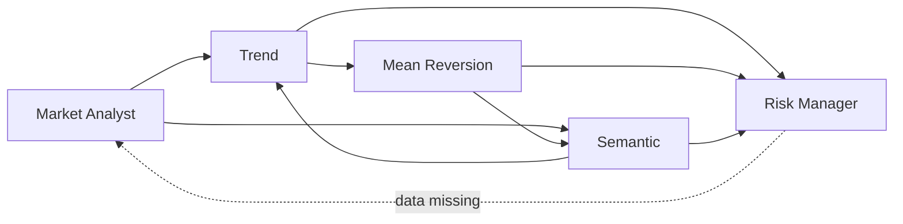

# Scheduling and agent decision-making

How PMTrader decides *when* to run an analysis, and *how* the agents reach a
recommendation once a run starts.

> **Status at time of writing:** no schedule is running. The scheduler exists but
> is switched off, so every run so far has been a manual `curl` call.

## Where the schedule lives

One file, one timer: `api/src/jobs/market-analysis-scheduler.ts`.

```typescript
export function startMarketAnalysisScheduler(): void {
  if (!config.agentScheduleEnabled) {
    return;
  }

  if (config.agentMarketIds.length === 0) {
    console.warn('AGENT_SCHEDULE_ENABLED is true but AGENT_MARKET_IDS is empty — scheduler idle.');
    return;
  }
  // ... runBatch loops over every market id ...
  void runBatch();
  timer = setInterval(() => {
    void runBatch();
  }, config.agentScheduleIntervalMs);
}
```

It is kicked off once at API startup, inside the `app.listen` callback in
`api/src/index.ts`.

## Why it is currently doing nothing

`.env` has **no** `AGENT_SCHEDULE_ENABLED` and **no** `AGENT_MARKET_IDS` lines.
The config reads them like this (`api/src/config.ts`):

```typescript
agentScheduleEnabled: process.env['AGENT_SCHEDULE_ENABLED'] === 'true',
/** Comma-separated market ids for the scheduler (e.g. POLY-3013350). */
agentMarketIds: (process.env['AGENT_MARKET_IDS'] ?? '')
  .split(',')
  .map((id) => id.trim())
  .filter(Boolean),
/** Interval between scheduled analysis runs in milliseconds. */
agentScheduleIntervalMs: Number(process.env['AGENT_SCHEDULE_INTERVAL_MS'] ?? 3_600_000),
```

`undefined === 'true'` is `false`, so `startMarketAnalysisScheduler()` returns
early and never sets a timer.

## Turning it on

Add these three lines to `.env`, then restart the API:

```bash
AGENT_SCHEDULE_ENABLED=true
AGENT_MARKET_IDS=POLY-3013350
AGENT_SCHEDULE_INTERVAL_MS=3600000
```

Behaviour once enabled:

| Aspect | Behaviour |
|---|---|
| First run | Immediately at startup (`void runBatch()` before the interval) |
| Repeat | Every `AGENT_SCHEDULE_INTERVAL_MS` — default `3600000` ms = 1 hour |
| Markets | Every id in `AGENT_MARKET_IDS`, **sequentially** (awaited one at a time) |
| Failures | Logged per market; one failure does not stop the others |
| Mode | Always the swarm path (no `deterministic` flag), so Ollama is used |

It is a plain `setInterval`, not cron — so "every hour" means "one hour after the
last batch *started*", not on the hour.

## How the agents decide what to do

There are two separate decision layers, and only one of them involves the LLM.

### Layer 1 — Routing (LLM decides)

There is **no supervisor**. Each agent is given handoff tools and its prompt tells
it who to pass control to. The graph of who *may* talk to whom is declared in
`api/src/agents/registry.ts`:



The Market Analyst always starts (`DEFAULT_ACTIVE_AGENT`). The Risk Manager has no
forward edge, which is what makes it the natural end of a run.
`SWARM_RECURSION_LIMIT=40` caps total steps so a handoff loop cannot spin forever.

In practice, Ollama often *skips* these tool calls entirely — that produces the
`model skipped specialist tools — filled 3 signal(s) deterministically` warning in
the console. The app then runs the specialist logic itself.

### Layer 2 — The actual trade decision (pure TypeScript, no LLM)

Once signals exist, the maths is fully deterministic.

**Step 1 — Blend the opinions** (`api/src/agents/risk-manager/aggregate.ts`). Each
signal becomes a Yes-probability, weighted by its own confidence. Disagreement is
priced in directly:

```typescript
const confidence = clamp01(meanConfidence * agreement);
```

Two equally confident, opposing agents produce near-zero final confidence. Neutral
signals contribute no weight at all — which is why all-neutral runs land on 0%.

**Step 2 — Pick a side** only if the blend is off-centre by more than
`DECISION_MARGIN` (0.03) *and* confidence is above zero. Otherwise `hold`.

**Step 3 — Apply veto rules** (`api/src/agents/risk-manager/logic.ts`). Any one of
these blocks the trade:

- Market is not `open`
- Blend came back `hold`
- Confidence below `SWARM_MIN_CONFIDENCE` (0.55)
- Liquidity score below 0.15
- Past close time
- Sized position below `SWARM_MIN_POSITION_USD` ($5)

**Step 4 — Size it.** `maxPositionUsd × convictionScale × liquidityScore`, where
conviction is measured *above* the 0.55 threshold, so a barely-approved trade
stakes small (floor of 25%).

So the LLM shapes *narrative and routing*; money decisions are governed entirely by
explicit, testable rules.

## Notes and known issues

**The design strength:** the LLM never decides whether to risk money. Every veto
carries a human-readable reason, and the rules live in pure functions with injected
limits (`RiskLimits`) so they can be unit-tested without env vars.

**Two things to watch:**

1. **`setInterval` does not wait for the batch to finish.** If a swarm run takes
   longer than the interval (observed: 65 seconds for a single market), batches can
   overlap. A `setTimeout` that reschedules *after* `runBatch()` resolves would be
   safer.

2. **Stale config in `.env`.** `MEMORY_DRIVER` and `MEMORY_FILE_PATH` are no longer
   read by anything since the MongoDB switch. `MONGODB_URI` also uses `localhost`;
   the code rewrites it to `127.0.0.1` automatically, but writing `127.0.0.1`
   directly avoids the IPv6 connection problem entirely.
